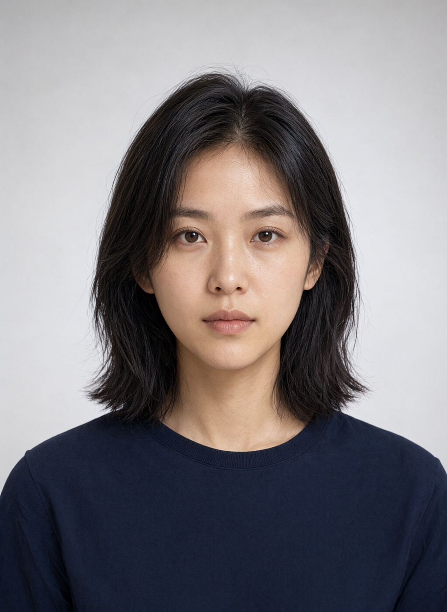
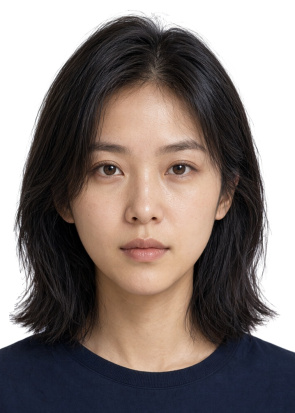
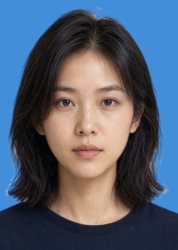
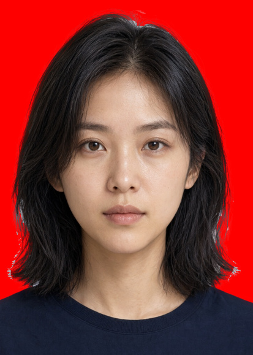
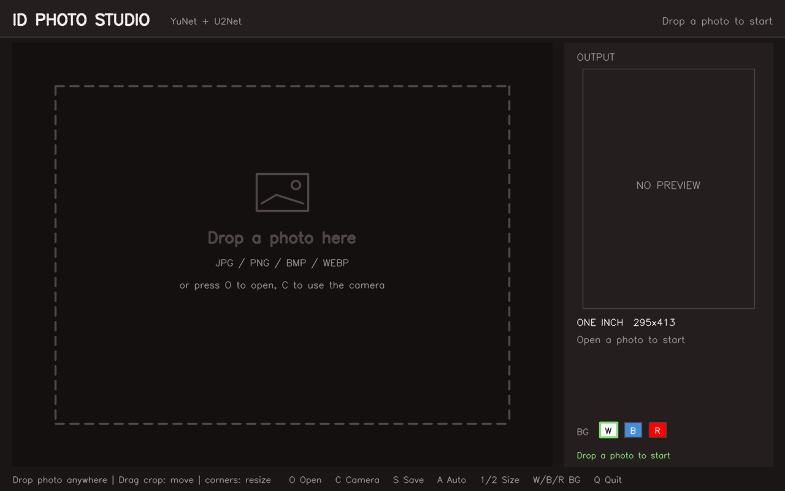
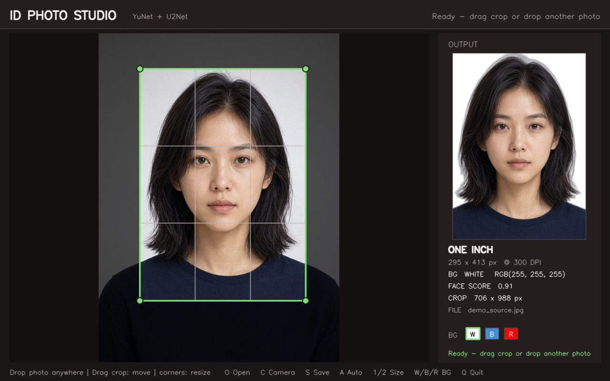

# 证件照自动裁剪与背景替换工具

基于 OpenCV + YuNet + rembg（IS-Net）的本地证件照工具：自动识别人脸、按标准比例构图、抠出人像并替换红/蓝/白/自定义纯色背景。提供支持文件拖放的桌面界面和命令行两种用法，支持一寸、二寸及自定义像素尺寸。



| 一寸 · 白底 | 一寸 · 蓝底 | 二寸 · 红底 |
| :---: | :---: | :---: |
|  |  |  |
| 295×413 @ 300 DPI | 295×413 @ 300 DPI | 413×579 @ 300 DPI |

> 演示人像由 AI 生成，仅用于展示处理效果，不是真实人物。

## 功能

- **人脸检测**：默认使用 YuNet DNN（检测前把长边缩到 1080 以内再推理，大图置信度更稳），模型缺失时自动回退到 Haar 级联。
- **自动构图**：以人脸尺寸和位置计算证件照裁剪框，保证头部比例与留白。
- **人像抠图**：rembg + IS-Net，本地推理，无需上传照片。
- **背景替换**：白、蓝、红三种预设，或自定义 `R,G,B` / `#RRGGBB`。
- **标准规格**：一寸 25×35 mm、二寸 35×49 mm，按 300 DPI 输出。
- **手动微调**：拖动裁剪框移动，拖动四角按 5:7 比例缩放。
- **摄像头拍摄**：实时预览、镜像拍摄，拍完直接进入处理流程。
- **拖放载入**：把 JPG/PNG/BMP/WEBP 图片直接拖进编辑区即可自动检测和抠图，也可以按 `O` 选择文件。
- **双入口**：桌面界面适合交互调整，命令行适合批量和脚本化。
- **隐私**：处理全程在本机完成；只有首次安装时需要联网下载模型。

## 环境与安装

要求：Python 3.10+、Linux 桌面环境（GUI 需要显示服务和 Tk 支持）。Ubuntu 若缺少 Tk，请先安装 `python3-tk`（需要 sudo）；拖放组件 `tkinterdnd2` 由安装脚本自动装好。已在 Ubuntu + Python 3.10.12 上验证。

```bash
git clone https://github.com/elac1/opencv-idphoto-background-replacement.git
cd opencv-idphoto-background-replacement
./scripts/setup.sh
```

`setup.sh` 会：

1. 创建项目内虚拟环境 `.venv/`（系统缺少 `python3-venv` 时自动改用用户级 `virtualenv`，无需 sudo）。
2. 安装 `requirements.txt` 中锁定的依赖（含拖放组件 `tkinterdnd2`），并以 `--no-deps` 安装 rembg，避免它带入与 OpenCV 桌面版冲突的 `opencv-python-headless`。
3. 下载 YuNet（约 232 KB）与抠图模型（IS-Net，约 170 MB）到 `models/`，并校验抠图模型的 SHA-256。模型名取自 `idphoto/config.py` 的 `SEGMENT_MODEL`，改这一处即可换模型。首次安装耗时取决于网络，之后可离线使用。

也可以手动安装：

```bash
python3 -m venv .venv
.venv/bin/pip install -r requirements.txt
.venv/bin/pip install --no-deps rembg==2.0.69
.venv/bin/python -m idphoto --help
```

模型文件会被自动忽略，不进入 Git；缺失时程序会提示先运行安装脚本。

## 桌面界面

```bash
./scripts/run.sh photo.jpg          # 打开指定图片
./scripts/run.sh                    # 无图片时自动打开 0 号摄像头
./scripts/run.sh --no-camera        # 打开空白编辑器
./scripts/run.sh --camera 1         # 指定摄像头索引
```

界面左侧为原图与裁剪框（框外区域压暗、显示三分线），右侧为实时预览和参数面板。空白编辑器中有一个虚线拖放区：把图片文件从文件管理器拖到窗口任意位置即可自动加载，拖入时边框会高亮；已经载入图片后也可以直接拖入新图替换。





| 操作 | 按键 / 鼠标 |
| --- | --- |
| 打开图片 | `O` |
| 拖入图片（可替换当前图） | 将文件拖到窗口任意位置 |
| 打开 / 关闭摄像头 | `C` |
| 摄像头拍摄 | `SPACE`（`ESC` 取消） |
| 保存到 `outputs/` | `S` |
| 按人脸重新自动构图 | `A` |
| 切到一寸 / 二寸 | `1` / `2` |
| 白 / 蓝 / 红底 | `W` / `B` / `R` |
| 移动裁剪框 | 在框内拖动 |
| 缩放裁剪框 | 拖动四角（保持输出比例） |
| 退出 | `Q` 或 `ESC` |

保存文件名为 `outputs/idphoto_YYYYmmdd_HHMMSS_{规格}_{底色}.jpg`，例如 `idphoto_20261019_143000_one-inch_white.jpg`。

## 命令行

```bash
# 一寸白底，默认输出到 outputs/
.venv/bin/python -m idphoto photo.jpg

# 二寸蓝底
.venv/bin/python -m idphoto photo.jpg --size two-inch --bg blue

# 自定义背景色（R,G,B 或 #RRGGBB）与输出路径
.venv/bin/python -m idphoto photo.jpg --rgb 67,142,219 -o outputs/custom.jpg
.venv/bin/python -m idphoto photo.jpg --rgb '#438EDB' -o outputs/

# 自定义像素尺寸
.venv/bin/python -m idphoto photo.jpg --pixels 295x413

# 强制使用 Haar 检测器（例如排查 YuNet 问题）
.venv/bin/python -m idphoto photo.jpg --detector haar
```

常用参数：

| 参数 | 说明 |
| --- | --- |
| `-o, --output` | 输出文件或目录；省略时为 `outputs/` |
| `--size` | `one-inch`（默认）或 `two-inch` |
| `--pixels WxH` | 自定义像素尺寸，与 `--size` 互斥 |
| `--bg` | `white`（默认）、`blue`、`red` |
| `--rgb` | 自定义背景色，与 `--bg` 互斥 |
| `--detector` | `auto`（默认）、`yunet`、`haar` |
| `--quality` | JPEG 质量 1–100，默认 95 |

默认输出名为 `{原文件名}_{规格}_{底色}.jpg`，例如 `photo_one-inch_white.jpg`。支持 JPG/JPEG/PNG 导出，JPEG 会写入 300 DPI 元数据并采用 4:4:4 色度采样。

## 规格与构图规则

| 规格 | 物理尺寸 | 输出像素（300 DPI） | 比例 |
| --- | --- | --- | --- |
| 一寸 | 25×35 mm | 295×413 | ≈5:7 |
| 二寸 | 35×49 mm | 413×579 | ≈5:7 |

自动构图以检测到的最大人脸为基准：

- 裁剪框高度 = `2.0 × 人脸高度`
- 裁剪框宽度 = `裁剪框高度 × 输出宽高比`
- 裁剪框上边 = `人脸上边 − 0.45 × 人脸高度`
- 人脸水平中心与裁剪框水平中心对齐，超出原图时自动向图内平移并等比调整。

这些参数集中在 `idphoto/config.py`，可按拍摄习惯调整。

## 工作流程

```text
读取图片（EXIF 转正）
      ↓
人脸检测（YuNet DNN / Haar 回退，检测前缩放到长边 ≤1080）
      ↓
计算裁剪框（人脸比例 + 输出宽高比）
      ↓
人像分割（rembg IS-Net → alpha）
      ↓
抠图后处理（补洞 → 细化 alpha → 颜色线重解 alpha → 去背景色污染）
      ↓
预乘 Alpha 缩放与纯色背景合成
      ↓
按目标像素输出（JPEG/PNG，写入 DPI）
```

合成阶段使用预乘 Alpha，避免半透明发丝边缘在缩放后出现暗边；背景色使用 RGB 定义，在 OpenCV 的 BGR 边界处显式转换。

### 为什么换底色会出现"白边"，以及怎么解决

这是抠图换底色最常见的坑，根因不在合成，而在**前景色本身**。

拍摄时，发丝边缘的半透明像素本就混合了当时的背景色：

```text
C = a · F + (1 - a) · B0      F=真实发色  B0=原背景色  a=真实不透明度
```

如果直接把原图 RGB 当作前景色 `F` 贴到新背景 `B1` 上，展开后是：

```text
out = C · a + B1 · (1 - a) = a²·F + a(1-a)·B0 + (1-a)·B1
                                ^^^^^^^^^^^^^ 凭空多出来的原背景色
```

只要原背景是浅色（白墙、白布、灰白影棚底），深色新背景上就必然出现一圈灰白 halo。

`segmenter.py` 的后处理按五步解决，顺序不能颠倒：

| 步骤 | 函数 | 作用 |
| --- | --- | --- |
| 1. 补洞 | `fill_holes` + `keep_largest_component` | 模型常把深色头发/衣服误判成背景，在人物内部挖洞；从图像外边界灌水，灌不到的区域即为内部空洞，补成不透明 |
| 2. 细化 alpha | `refine_alpha` | 模型 alpha 是低分辨率上采样的，在发丝处"该透不透、该实不实"。引导滤波（guided filter）以灰度图为引导，把 alpha 重新对齐到真实图像边缘 |
| 3. **颜色线重解 alpha** | `color_line_alpha` | 上面两层都救不了的情况：模型在虚焦发丝处把 alpha 判成接近 1，那片像素的颜色其实就是原背景色。给再高的 alpha 也变不出头发，只能按 `C = a·F + (1-a)·B` 用内/外两侧外推出的 F、B 反解 `a = (C-B)·(F-B)/‖F-B‖²` |
| 4. **去背景色污染** | `estimate_background_field` + `decontaminate` | 在原背景上拟合平滑背景色场 `B(x,y)`，再反解 `F = (C - (1-a)·B) / a`，把夹带进去的背景色减掉 |
| 5. 内收兜底 | `trim_alpha` | 可选，沿轮廓内收 1~2px（会牺牲发丝，默认关闭） |

第 3 步和第 4 步解决的是两种不同病因，缺一不可：

- **第 3 步治"alpha 给多了"**。典型画面是头顶那圈发丝：模型判成不透明，像素颜色却还是原来的浅灰白底色。这类像素无论怎么去污染，反解结果仍是灰白，贴到蓝/红底上就是一圈白光 —— 错的是 `a` 本身，必须重解。
- **第 4 步治"颜色夹带了背景"**。alpha 判得对，但半透明像素的 RGB 里混着原背景色，需要减掉。

因此 `cutout()` 返回的 RGBA 里，**RGB 不一定等于原图对应像素**，alpha 也可能与模型输出不同，这都是刻意的；不要为了"看着像原图"把它们改回去。

第 3 步只在背景场可信（第 4 步的闸门通过）时执行。前背景颜色过于接近时（白衬衫配白底），投影会退化成噪声，此时保留模型原 alpha。

背景色为什么不取一个全局颜色，而要拟合一张场：真实照片的背景几乎从不是绝对纯色 —— 墙面明暗不均、影棚布光渐变、镜头暗角都会让背景色在画面上漂移几十个灰阶。只用一个中位数去反解，估偏的部分会原样留在边缘，深色底上依然是白边。`estimate_background_field` 把画面切成小块统计背景均值、对被人像盖住的块做 inpaint 外推，再向上采样成低频场，因此渐变背景也能跟上。

安全性：是否启用拟合场，看的是"背景像素与拟合场的**残差**"（`BACKGROUND_SOLID_TOLERANCE`），而不是背景本身的起伏。所以渐变背景能通过，真正杂乱（树叶、碎花、贴纸）的背景残差很大，会被挡下并自动跳过反解，避免把前景颜色改坏。

抠图模型由 `SEGMENT_MODEL` 决定（默认 `isnet-general-use`），换模型只改这一处，`setup.sh` 会据此下载对应权重：

| 模型 | 体积 | 说明 |
| --- | --- | --- |
| `isnet-general-use` | 约 170 MB | **默认**。实测发丝边缘最干净，白边像素最少，代价是比 u2net 慢约 1.4 s |
| `u2net` | 约 168 MB | rembg 默认模型，速度快，边缘略糊 |
| `u2net_human_seg` | 约 168 MB | 人像专用微调；实测在本项目样本上边缘偏硬、残留白边反而略多 |

> 上述结论来自本仓库演示图与一张白底证件照的对比（红/蓝底上的"白边像素"与"环带亮度"），不是通用排名；换一批照片排序可能变化，建议在自己的素材上验证。

可调参数集中在 `idphoto/config.py` 的"抠图后处理"一节：

| 参数 | 默认 | 说明 |
| --- | --- | --- |
| `SEGMENT_MODEL` | `isnet-general-use` | 抠图模型名，见上表 |
| `ALPHA_MATTING` | `True` | 走 pymatting 闭式抠图，发丝过渡带最自然、残留白边最轻，代价是耗时翻倍；追求速度可关掉 |
| `ALPHA_REFINE_RADIUS` | `6` | 引导滤波半径，越大越贴合真实轮廓，过大会磨平细节 |
| `BACKGROUND_SOLID_TOLERANCE` | `20.0` | 背景场拟合残差容差，超过则判定背景不可靠、跳过反解 |
| `COLOR_LINE_RADIUS` | `10` | 轮廓带内重解 alpha 的宽度（像素），`0` 关闭。越大越能压住虚焦发丝，过大会把细发丝也一起吃掉 |
| `DECONTAMINATE_FLOOR` | `0.25` | 反解时 alpha 的下限，防止除零放大噪点 |
| `EDGE_TRIM_PX` | `0` | 额外内收像素数，兜底用 |

也可以只对某次调用生效：

```python
from idphoto.segmenter import PortraitSegmenter
from idphoto.pipeline import IDPhotoProcessor

segmenter = PortraitSegmenter(model_name="u2net", alpha_matting=True, edge_trim_px=1)
processor = IDPhotoProcessor(segmenter=segmenter)
```

> 提示：较新的 rembg 自带 `decontaminate=True` 参数可直接去白边，但本项目锁定的 `rembg==2.0.69` 没有该参数（也没有 `vitmatte`），所以这里自行实现，不依赖版本升级。


## 项目结构

```text
idphoto/
  config.py      规格、构图参数、背景色、颜色解析
  io_utils.py    图片读取（EXIF）与带 DPI 的导出
  detector.py    YuNet / Haar 人脸检测
  compose.py     裁剪框计算与 Alpha 合成
  segmenter.py   rembg IS-Net 人像分割与边缘后处理
  pipeline.py    检测 → 抠图 → 合成 的编排
  cli.py         命令行入口
  app.py         Tkinter Canvas + tkinterdnd2 桌面界面，画面由 OpenCV 绘制
scripts/
  setup.sh       环境、依赖与模型安装
  run.sh         一键启动桌面界面
tests/           单元测试与本地集成测试
docs/images/     README 演示图片
models/          模型目录（Git 忽略）
outputs/         默认输出目录（Git 忽略）
```

项目内的 Qoder 技能位于 `.qoder/skills/idphoto/SKILL.md`，汇总了安装、运行、验收和常见问题，便于 AI 编码助手快速接手。

## 测试

```bash
.venv/bin/python -m unittest discover -s tests -v
```

共 58 个测试，覆盖规格换算、颜色解析、构图与边界钳制、预乘合成、抠图后处理（补洞 / alpha 细化 / 颜色线重解 / 背景场拟合 / 去背景色污染）、人脸检测的缩放与坐标还原、流水线编排、JPEG DPI 写入。真实人像集成测试需要私有测试图和两个模型，条件不满足时会自动跳过。

## 已知限制

- 每张图只处理**一个人脸**（取面积最大者），不支持合影分别裁切。
- 渐变、明暗不均的纯色背景（墙面、影棚布）已能正确处理；但背景**高频杂乱**（树叶、碎花、贴纸）时会自动跳过去污染，此时边缘仍可能有残影，建议在干净背景前拍摄。
- 摄像头实时预览需要逐帧缩放、格式转换并经 Tk 刷新，CPU 占用会明显高于静态模式；静态编辑模式已做脏标记优化，空闲时占用很低。
- 拖放依赖 `tkinterdnd2` / tkdnd；Linux 桌面使用 X11/Xdnd，Wayland 会话通过 XWayland 提供支持。
- 证件照尺寸要求因国家、地区、用途而异；本项目按常见的 25×35 mm / 35×49 mm 生成，正式提交前请以受理机构要求为准。
- 桌面界面需要图形显示；服务器或无显示环境请使用命令行。

## 模型与许可

| 组件 | 用途 | 许可 |
| --- | --- | --- |
| [OpenCV](https://github.com/opencv/opencv) | 图像处理与 GUI | Apache-2.0 |
| [YuNet / OpenCV Zoo](https://github.com/opencv/opencv_zoo/tree/main/models/face_detection_yunet) | 人脸检测 | MIT |
| [IS-Net / DIS](https://github.com/xuebinqin/DIS) | 人像分割（默认） | Apache-2.0 |
| [U²-Net](https://github.com/xuebinqin/U-2-Net) | 人像分割（可选 `u2net` 系列） | Apache-2.0 |
| [rembg](https://github.com/danielgatis/rembg) | 分割推理封装 | MIT |

模型权重在安装时从上游/镜像下载，不随仓库分发。使用本项目产出证件照时，请同时遵守图片来源、人物肖像权及受理机构的规范。
